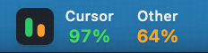
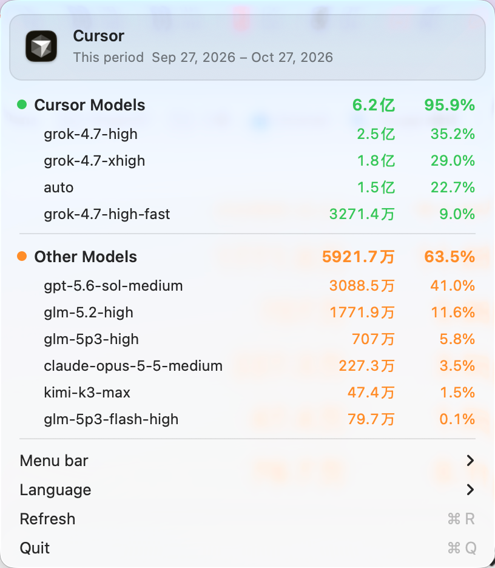

# Cursor Usage Bar

A macOS menu-bar app that shows the included usage from the [Cursor billing page](https://cursor.com/dashboard/billing).

Cursor Models and Other Models sit side by side. The name is on top and the number is underneath. Open the menu to see each model.





Switch the menu between Chinese and English from **语言** / **Language**. Until you choose, it follows the system language. `default` from the API is shown as `auto`. Token amounts stay in 万 / 亿 so they match the billing page.

## Requirements

- macOS 14 or later
- [Cursor](https://cursor.com) installed and signed in on this Mac
- Swift 6 or later to build from source

## Install

There is no notarized download yet. Build it locally:

```bash
git clone https://github.com/jusong/cursor-usage-bar.git
cd cursor-usage-bar
./scripts/package-app.sh
open CursorUsage.app
```

The app does not appear in the Dock. After you quit it from the menu, open `CursorUsage.app` again.

`./scripts/package-app.sh` signs the app for the current Mac only. Gatekeeper will block that build on another Mac until it is signed with a Developer ID and notarized.

## Menu bar

Choose the detail level from **顶部栏显示** / **Menu bar**. The choice is remembered.

| Mode | Example |
| --- | --- |
| Percent | `94%` under the name |
| Percent and tokens | `6.0亿 94%` under the name |
| Tokens only | `6.0亿` under the name |

Cursor numbers are green. Other numbers are orange. The menu always lists tokens and a one-decimal percentage, whatever the menu bar is showing. The menu bar rounds percentages to the nearest integer, so `95.6%` in the menu can read `96%` in the bar.

Usage refreshes when the app launches, every 5 minutes, and when you choose **刷新**.

## How usage is loaded

The app reads the Cursor login already stored on this Mac. It does not ask you to paste a cookie.

1. Open `~/Library/Application Support/Cursor/User/globalStorage/state.vscdb` read-only and read `cursorAuth/accessToken`.
2. `POST https://cursor.com/api/dashboard/get-current-period-usage` for the billing period and the two pool percentages.
3. `POST https://cursor.com/api/dashboard/get-aggregated-usage-events` for per-model tokens and cost, using that same period.

Pool percentages come from Cursor. Each model's percentage is that pool's percentage split by the model's share of the pool's cost. These are the same private endpoints the billing page uses. They are not a documented public API and can change.

## Privacy

The only network calls are those two requests to `cursor.com`. They send the existing Cursor session cookie and the billing-period dates. Usage figures are downloaded, not uploaded. No usage, source code, or local files are sent anywhere else.

The only value stored by this app is the menu-bar display mode.

## Development

```bash
swift run CursorUsageCoreChecks
swift run CursorUsageBar --dump
```

`CursorUsageCoreChecks` checks formatting, grouping, and JSON decoding without signing in. `--dump` prints the current account's usage to the terminal and does not open the menu bar. It does not print the session token.

## License

[MIT](LICENSE)

Cursor Usage Bar is an independent project. It is not affiliated with Anysphere or Cursor. Cursor and the Cursor logo are trademarks of their owner. The menu-bar icon is loaded from a local Cursor installation when one is present.
