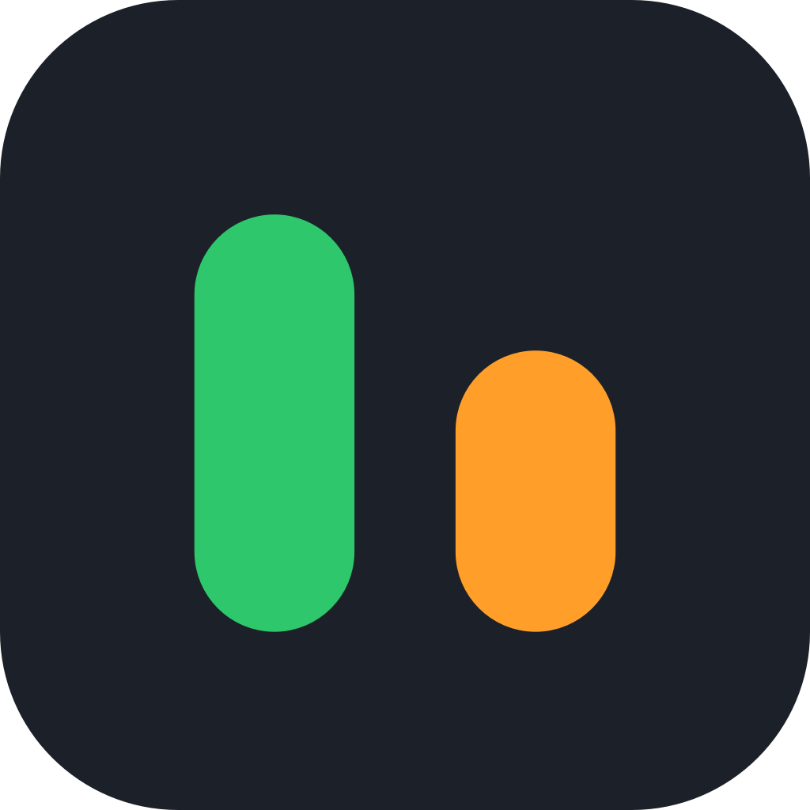

# Cursor Usage Bar



A macOS menu-bar app that shows the included usage from the [Cursor billing page](https://cursor.com/dashboard/billing).

Cursor Models and Other Models sit side by side. The name is on top and the number is underneath. Open the menu to see each model.


Switch the menu between English and Chinese from **Language**. English is the default until you choose. `default` from the API is shown as `auto`. Large token counts use compact Chinese number units.

## Requirements

- macOS 14 or later (Apple Silicon or Intel)
- [Cursor](https://cursor.com) installed and signed in on this Mac

## Install

Download [CursorUsage-1.0.0.dmg](https://github.com/jusong/cursor-usage-bar/releases/download/v1.0.0/CursorUsage-1.0.0.dmg) (universal), open it, and drag the app into Applications.

This build is ad-hoc signed and is not notarized. After copying it out of the disk image, clear the download quarantine flag, then open it:

```bash
xattr -dr com.apple.quarantine /Applications/CursorUsage.app
open /Applications/CursorUsage.app
```

The app does not appear in the Dock. After you quit it from the menu, open `CursorUsage.app` again.

To build it yourself you need Swift 6 or later:

```bash
git clone https://github.com/jusong/cursor-usage-bar.git
cd cursor-usage-bar
./scripts/package-app.sh
open CursorUsage.app
```

## Menu bar

Choose the detail level from **Menu bar**. The choice is remembered.

| Mode | Example |
| --- | --- |
| Percent | `94%` under the name |
| Percent and tokens | compact token count, then `94%` |
| Tokens only | compact token count |

Cursor numbers are green. Other numbers are orange. The menu always lists tokens and a one-decimal percentage, whatever the menu bar is showing. The menu bar rounds percentages to the nearest integer, so `95.6%` in the menu can read `96%` in the bar.

Usage refreshes when the app launches, every 5 minutes, and when you choose **Refresh**.

## How usage is loaded

The app reads the Cursor login already stored on this Mac. It does not ask you to paste a cookie.

1. Open `~/Library/Application Support/Cursor/User/globalStorage/state.vscdb` read-only and read `cursorAuth/accessToken`. Current Cursor builds store it encrypted, so the app asks macOS (through Apple's `security` tool) for the **Cursor Safe Storage** password, once per launch, and decrypts the token in memory. Neither the password nor the token is saved by this app.
2. `POST https://cursor.com/api/dashboard/get-current-period-usage` for the billing period and the two pool percentages.
3. `POST https://cursor.com/api/dashboard/get-aggregated-usage-events` for per-model tokens and cost, using that same period.

Pool percentages come from Cursor. Each model's percentage is that pool's percentage split by the model's share of the pool's cost. These are the same private endpoints the billing page uses. They are not a documented public API and can change.

## Privacy

The only network calls are those two requests to `cursor.com`. They send the existing Cursor session cookie and the billing-period dates. Usage figures are downloaded, not uploaded. No usage, source code, or local files are sent anywhere else.

This app only stores the menu-bar display mode and the language you choose.

## Development

```bash
swift run CursorUsageCoreChecks
swift run CursorUsageBar --dump
```

`CursorUsageCoreChecks` checks formatting, grouping, and JSON decoding without signing in. `--dump` prints the current account's usage to the terminal and does not open the menu bar. It does not print the session token.

## License

[MIT](LICENSE)

Cursor Usage Bar is an independent project. It is not affiliated with Anysphere or Cursor. Cursor is a trademark of its owner. The app icon is original: two usage bars, green and orange, on a dark rounded square.
